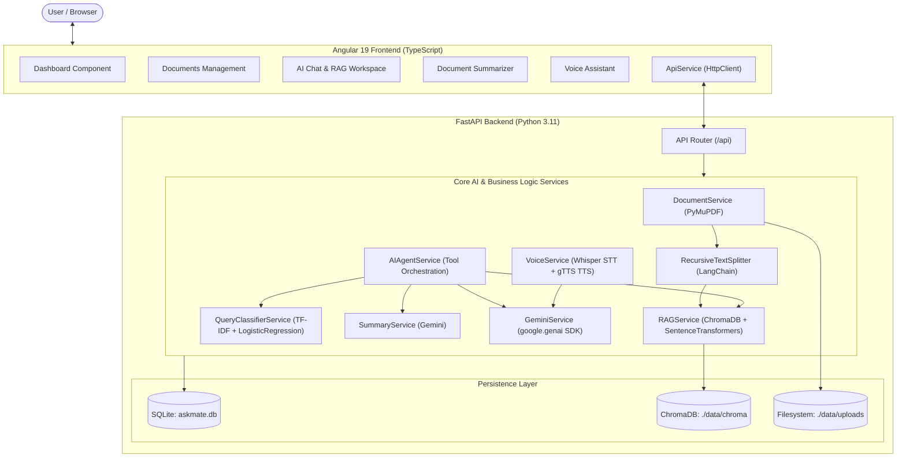

# AskMate – AI Knowledge Assistant

<div align="center">


**AskMate** is a full-stack, modular AI Knowledge Assistant that allows users to upload PDF documents, ask questions using text or voice, receive document-grounded answers with exact page citations, generate structured document summaries, and execute tasks via an intelligent, safety-bounded AI agent.

</div>

---

## Architecture Overview



---

## Core Features

### 1. PDF Document Upload & Validation
- Validates file format (`.pdf`), magic bytes (`%PDF-`), and enforces a 25MB maximum size limit.
- Extracts text page-by-page using PyMuPDF (`fitz`).
- Chunks text preserving page numbers and chunk offsets using `RecursiveCharacterTextSplitter`.
- Stores metadata in SQLite and generates dense vector embeddings using `SentenceTransformers (all-MiniLM-L6-v2)` persisted in ChromaDB.
- Cascading deletion: deleting a document removes the physical file, database records, and ChromaDB vector embeddings.

### 2. Retrieval-Augmented Generation (RAG) with Citations
- Encodes queries into dense vector space and executes cosine similarity search in ChromaDB.
- Assembles grounded context excerpts with source document names and page numbers.
- Prompts Google Gemini with factual constraints (low temperature = 0.2) to prevent hallucinations.
- If the uploaded documents do not contain sufficient evidence, the model honestly refuses to speculate.
- Displays interactive **Source Citations Cards** below answers, showing document filename, page badge, relevance score percentage, and exact matching excerpt.

### 3. AI Agent Tool Orchestration
The agent selects the appropriate tool based on user intent:
1. `document_qa`: Grounded question answering over indexed documents with source citations.
2. `summarize_document`: Executive, detailed, or key-point summaries.
3. `search_documents`: Direct semantic excerpt retrieval without synthetic answer generation.
4. `general_response`: General conversational, coding, or knowledge queries.

> **Security Guardrail**: Tool calls are strictly bounded to safe, deterministic Python functions. Arbitrary code execution (`eval`, `exec`, shell subprocesses) is strictly prevented.

### 4. Document Summarization
Supports three summary formats:
- **Short Summary**: Concise 2–3 paragraph executive summary of the document's purpose, arguments, and conclusions.
- **Detailed Summary**: In-depth section-by-section breakdown organized with markdown headings.
- **Key Points**: High-impact bulleted list of essential takeaways, critical metrics, and actionable items with structured JSON parsing.

### 5. Voice Interaction (Speech-to-Text & Text-to-Speech)
- **Speech-to-Text (STT)**: Transcribes recorded audio or uploaded audio files (`.wav`, `.mp3`, `.m4a`, `.webm`, `.ogg`) using OpenAI Whisper.
- **AskMate Pipeline**: Automatically feeds the transcribed query into the agent pipeline.
- **Text-to-Speech (TTS)**: Synthesizes responses into spoken audio using `gTTS` with markdown formatting stripped for natural prosody.
- **Audio Playback**: Interactive HTML5 audio player and one-click replay in both the Voice Assistant page and the Chat interface.

### 6. Context-Aware Query Clarification
- Detects ambiguous, incomplete, or isolated follow-up queries (e.g. *"Explain that in more detail"*, *"What does it mean?"*, *"Why?"*).
- When conversation history is present, resolves the antecedent from prior turns.
- When conversation history is empty or required context is missing, flags `clarification_needed = True` and prompts the user with clarifying questions rather than guessing.

### 7. Scikit-Learn Query Classification
- Lightweight Machine Learning classifier built using `TfidfVectorizer(ngram_range=(1, 2))` and `LogisticRegression(class_weight="balanced")`.
- Classifies user queries into 4 classes:
  - `Document Question`
  - `Summarization`
  - `General Question`
  - `Clarification Required`
- Returns probability distributions and assists agent tool routing, falling back to LLM semantic analysis for uncertain predictions.

---

## API Endpoints Reference

All API routes are served under `/api`:

| Method | Endpoint | Description |
|---|---|---|
| `GET` | `/api/health` | Health check returning status, database state, ChromaDB vectors count, and Gemini config. |
| `POST` | `/api/documents/upload` | Upload and index a PDF document into SQLite and ChromaDB. |
| `GET` | `/api/documents` | List all uploaded documents with metadata (pages, chunks, size). |
| `DELETE` | `/api/documents/{id}` | Delete document file, database record, and associated ChromaDB vectors. |
| `POST` | `/api/chat` | Send a chat query with conversation history, document filtering, and AI Agent routing. |
| `POST` | `/api/summary` | Generate a `short`, `detailed`, or `key_points` summary of an uploaded document. |
| `POST` | `/api/voice/transcribe` | Transcribe an audio file into text using OpenAI Whisper. |
| `POST` | `/api/voice/speak` | Synthesize text into speech MP3 audio stream using gTTS. |

Interactive Swagger documentation is available at `http://localhost:8000/docs`.

---

## Technology Stack

### Frontend
- **Framework**: Angular 19 (Standalone Components, TypeScript)
- **Styling**: Modern, responsive CSS with CSS Grid & Flexbox
- **Icons**: Google Material Icons
- **HTTP**: Angular `HttpClient` with RxJS Observables

### Backend
- **Framework**: FastAPI (Python 3.11)
- **Data Validation**: Pydantic v2
- **ORM & Database**: SQLAlchemy & SQLite (`./data/askmate.db`)
- **Server**: Uvicorn ASGI

### AI & Machine Learning
- **LLM Operations**: Google Gemini API (`google-genai` SDK, `gemini-3.5-flash-lite`)
- **Vector Database**: ChromaDB (`./data/chroma`)
- **Embedding Model**: Sentence Transformers (`all-MiniLM-L6-v2`)
- **PDF Extraction**: PyMuPDF (`fitz`)
- **Text Chunking**: LangChain `RecursiveCharacterTextSplitter`
- **Query Classification**: Scikit-Learn (`TfidfVectorizer` + `LogisticRegression`)
- **Speech-to-Text**: OpenAI Whisper (`tiny` model with bundled `imageio-ffmpeg`)
- **Text-to-Speech**: Google Text-to-Speech (`gTTS`)

---

## Getting Started

### 1. Prerequisites
- Python 3.11+
- Node.js 18+ & npm

### 2. Backend Setup
1. Open a terminal in the project directory:
```bash
cd backend
```
2. Configure your environment variables in `backend/.env`:
```env
GEMINI_API_KEY="your-google-gemini-api-key"
```
3. Run the FastAPI backend:
```bash
python run.py
```
*Backend will be active at `http://localhost:8000`.*

### 3. Frontend Setup
1. In a new terminal, navigate to the frontend directory:
```bash
cd frontend
npm install
```
2. Launch the Angular development server:
```bash
npm start
```
*Open `http://localhost:4200` in your browser.*

---

## Running the Automated Test Suite

### Backend Unit Tests (29/29 Passing)
```bash
python -m pytest backend/tests -v
```
Test suite covers:
- System health checks and database tables initialization
- PDF file validation, upload, chunking, and ChromaDB vector deletion
- ChromaDB semantic retrieval and grounded RAG answer generation
- AI Agent tool selection (`document_qa`, `summarize_document`, `search_documents`, `general_response`)
- Contextual query clarification and follow-up resolution
- Document summarization (`short`, `detailed`, `key_points`)
- Scikit-learn TF-IDF + Logistic Regression query classification
- Whisper audio transcription and gTTS speech synthesis

### Frontend Build Verification
```bash
npm --prefix frontend run build
```
Generates a production bundle in `frontend/dist/frontend` with zero compilation errors.

---

## Security & Data Handling
- **API Key Protection**: Gemini API keys are loaded strictly from backend environment variables and never exposed to the client.
- **Input Validation**: Strict MIME type, magic bytes (`%PDF-`), and file size verification prevent malicious payloads.
- **Safe Execution**: No document contents or user inputs are evaluated as executable code.
- **Privacy**: Uploaded documents and vectors can be deleted at any time via the UI.
